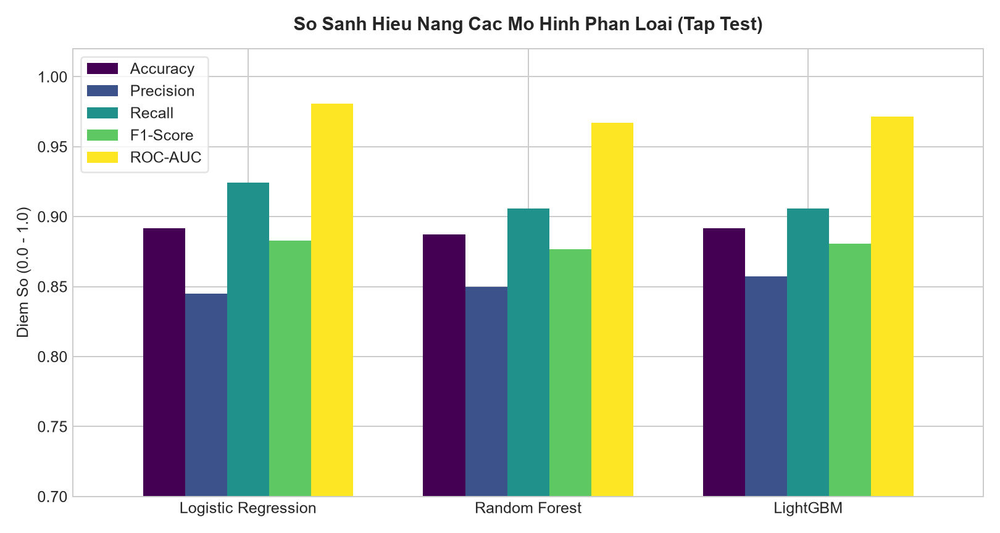

# Student Academic Risk Predictor

[Tiếng Việt](README.md) · [English](README.en.md)

A classification exercise using 1,200 **synthetic** student records. It demonstrates an ML workflow; it has not been validated on real students.



The chart uses saved models after validation-based selection. These scores describe the simulation dataset.

## Run

```sh
python -m venv .venv
# Activate the environment, then:
pip install -r requirements.txt
python -m src.train
python -m src.evaluate
python -m src.explain
python -m uvicorn app.main:app --port 8000
```

Open http://localhost:8000. Run tests with `python -m unittest discover -s tests`.

## Evaluation

A fixed, stratified 60/20/20 split separates train, validation and test. Logistic Regression, Random Forest and LightGBM are compared on validation, where the model and threshold are selected. Only then is test performance calculated. The model is not retrained after threshold selection.

`models/model_metadata.json` records sample counts and validation/test results. Charts use saved models rather than training a different model for the figure.

SHAP explains `best_model.joblib`. Logistic Regression contributions are in log-odds; for tree models the API's `output_space` identifies the scale. Do not interpret SHAP values as percentage-point probability changes.

## Limits and files

`src/data_loader.py` generates labels from features and noise. High test scores mainly show that a model learned those simulation rules. Real use requires sourced data, evaluation across semesters and probability calibration checks.

- `src/train.py`: split, model comparison and threshold selection.
- `src/evaluate.py`: figures from saved models.
- `src/explain.py`: explanations for the prediction model.
- `app/`: API and profile form.
