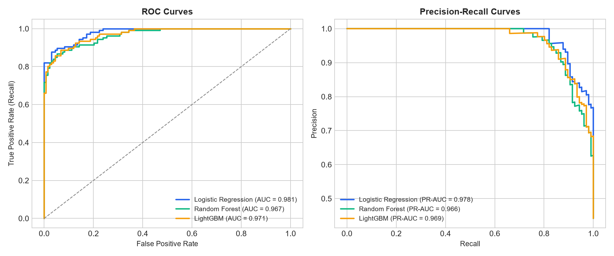
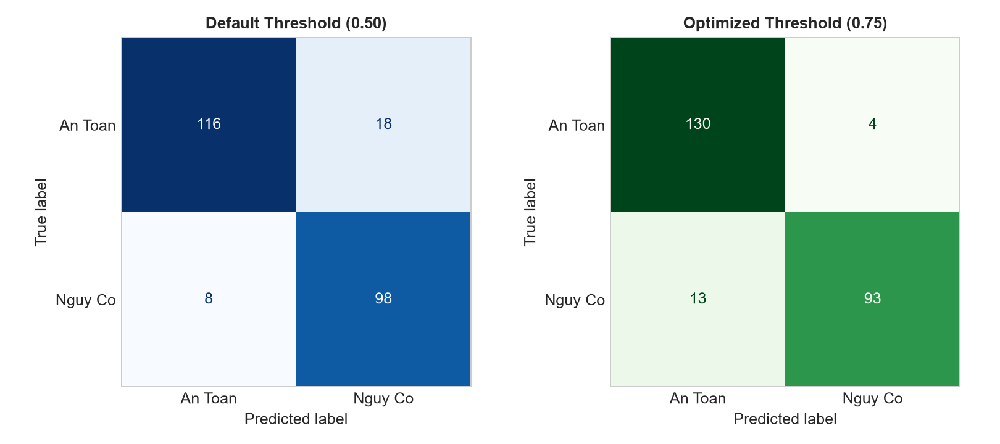
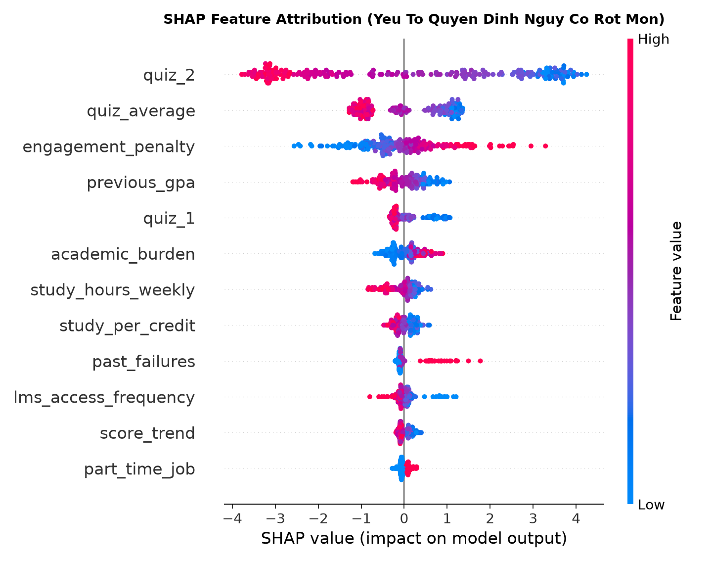
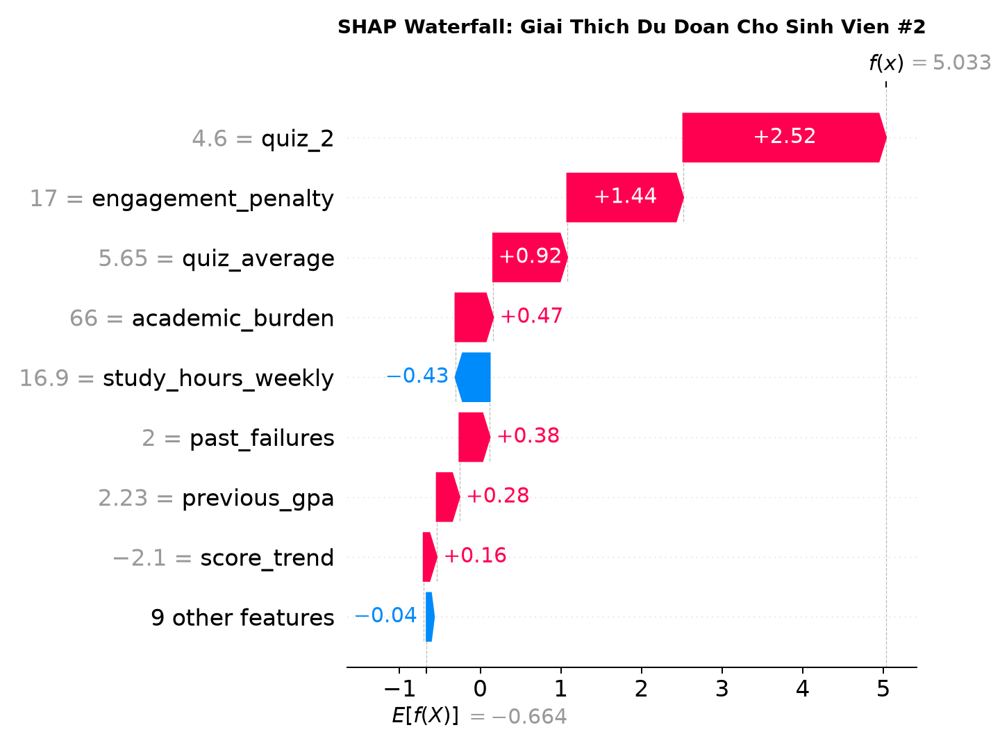

# Student Academic Risk Predictor

[Tiếng Việt](#tiếng-việt) • [English](#english)

---

<a name="tiếng-việt"></a>
# TIẾNG VIỆT

## 1. Bài Toán Thực Tế

Ở trường đại học, sinh viên thường chỉ nhận ra mình sắp rớt môn khi đã bước vào tuần 13 - 15. Lúc này thì điểm quá trình đã chốt, số buổi vắng đã vượt khung và gần như không còn cơ hội sửa sai.

Dự án này giải quyết bài toán: **Dựa vào dữ liệu học tập 6 - 8 tuần đầu (khi chưa hề có điểm thi cuối kỳ), làm sao phát hiện sớm sinh viên đang có nguy cơ rớt môn để kịp thời hỗ trợ?**

### Tại sao không dùng công thức tính điểm thông thường?
- Nếu chờ có điểm thi rồi nhân hệ số cộng lại thì đó chỉ là phép tính số học, không giúp ích gì cho việc can thiệp sớm.
- Ở giai đoạn giữa kỳ, hành vi học tập của sinh viên mang tính phi tuyến tính:
  - Có bạn điểm danh đầy đủ nhưng điểm kiểm tra lại tụt dần qua các tuần.
  - Có bạn vắng 2 buổi nhưng bài tập thực hành vẫn đạt điểm tốt.
  - Có bạn đang gánh quá nhiều tín chỉ kết hợp nợ môn ở kỳ trước, dẫn đến quá tải.
- Machine Learning giúp kết hợp các tín hiệu hành vi (chuyên cần, xu hướng điểm, tải học vụ, giờ tự học) để ước lượng xác suất rủi ro trước khi quá muộn.

---

## 2. Kết Quả Thử Nghiệm Đối Chiếu Các Mô Hình

Thử nghiệm được thực hiện trên 1,200 hồ sơ sinh viên, chia theo tỷ lệ 80% huấn luyện và 20% kiểm thử (Stratified Split để giữ nguyên tỷ lệ nhãn).

| Mô hình | Accuracy | Precision | Recall | F1-Score | ROC-AUC |
| :--- | :---: | :---: | :---: | :---: | :---: |
| **Logistic Regression (Baseline)** | 89.17% | 84.48% | **92.45%** | **88.29%** | **0.9807** |
| **LightGBM** | 89.17% | 85.71% | 90.57% | 88.07% | 0.9714 |
| **Random Forest** | 88.75% | 84.96% | 90.57% | 87.67% | 0.9673 |




---

## 3. Tối Ưu Ngưỡng Phân Loại (Threshold Tuning)

Trong bài toán hỗ trợ sinh viên:
- **False Negative (bỏ sót sinh viên sắp rớt môn):** Hậu quả rất lớn vì sinh viên đó sẽ rớt môn thật do không được nhắc nhở.
- **False Positive (nhắc nhở sinh viên chăm):** Hậu quả không đáng kể, chỉ là một email hỏi thăm từ cố vấn học tập.

Do đó, chúng ta thực hiện quét ngưỡng xác suất (Threshold Tuning):
- Ở ngưỡng tối ưu $\tau = 0.75$: Mô hình đạt **Precision 95.88%** mà vẫn giữ được **Recall 87.74%** và **F1-Score 91.63%**.
- Việc này giúp bộ phận cố vấn học tập lọc ra đúng nhóm sinh viên thực sự cần can thiệp mà không tạo ra cảnh báo giả tràn lan.



---

## 4. Giải Thích Mô Hình Bằng SHAP (Explainable AI)

Một mô hình đưa vào giáo dục không thể chỉ trả về con số chung chung "bạn có 80% nguy cơ rớt môn". Chúng ta sử dụng SHAP (SHapley Additive exPlanations) để chỉ ra nguyên nhân cụ thể:



### Các phát hiện chính từ SHAP:
1. **Điểm Quiz 2 và Điểm phạt vắng học (`engagement_penalty`):** Là hai chỉ báo mạnh nhất. Điểm Quiz 2 thấp (màu xanh) đẩy mạnh giá trị SHAP dương (tăng nguy cơ rớt môn).
2. **Xu hướng điểm (`score_trend`):** Sinh viên có điểm bài kiểm tra sau thấp hơn bài kiểm tra trước có nguy cơ rớt môn cao hơn rõ rệt so với sinh viên có điểm ổn định.
3. **Giải thích theo từng cá nhân (Waterfall Plot):**



---

## 5. Cấu Trúc Dự Án

```text
student-academic-risk-predictor/
├── data/
│   ├── raw/                      # Dữ liệu 1,200 sinh viên
│   └── processed/                # Dữ liệu sau khi trích xuất đặc trưng
├── src/
│   ├── data_loader.py            # Khởi tạo và nạp dữ liệu
│   ├── features.py               # Kỹ thuật tạo đặc trưng (Feature Engineering)
│   ├── train.py                  # Huấn luyện, đánh giá và tối ưu ngưỡng
│   ├── evaluate.py               # Sinh các biểu đồ đánh giá mô hình
│   └── explain.py                # Tính toán SHAP values toàn cục và cục bộ
├── notebooks/
│   └── student_risk_analysis.ipynb # Notebook phân tích dữ liệu chi tiết
├── app/
│   ├── main.py                   # FastAPI service phục vụ endpoint /api/predict
│   └── static/
│       └── index.html            # Giao diện chẩn đoán nguy cơ học vụ
├── reports/
│   └── figures/                  # Lưu trữ toàn bộ biểu đồ thực nghiệm
├── requirements.txt              # Danh sách thư viện
└── README.md                     # Tài liệu dự án
```

---

## 6. Hướng Dẫn Chạy Dự Án

### Bước 1: Kích hoạt môi trường ảo
```powershell
.\.venv\Scripts\Activate.ps1
```

### Bước 2: Chạy lại toàn bộ pipeline huấn luyện và sinh biểu đồ
```powershell
# Huấn luyện mô hình và lưu metadata
python src/train.py

# Sinh các biểu đồ đánh giá
python src/evaluate.py

# Sinh các biểu đồ giải thích SHAP
python src/explain.py
```

### Bước 3: Khởi động giao diện chẩn đoán
```powershell
python -m uvicorn app.main:app --port 8000
```
Truy cập trình duyệt: `http://localhost:8000` để thử nghiệm nạp các hồ sơ sinh viên mẫu.

---
---

<a name="english"></a>
# ENGLISH

## 1. Problem Statement

In higher education, struggling students often realize they are failing only around weeks 13 - 15, when progress grades are finalized and attendance rules make failure unavoidable.

This project addresses the problem: **Using academic and behavioral data from the first 6 - 8 weeks of the semester (before final exams exist), how can we identify students at risk of course failure early enough to provide targeted academic support?**

### Why not simple deterministic grading arithmetic?
- Final grade calculation is simple arithmetic, but it only happens after final exams are taken.
- At mid-semester, student performance signals are non-linear:
  - Some students attend all lectures but show declining test scores.
  - Some students miss 2 sessions but maintain strong practical lab marks.
  - Some carry an overloaded credit burden combined with past course failures.
- Machine Learning combines these early signals (attendance patterns, score trajectory, credit load, study hours) to estimate risk probabilities while intervention is still possible.

---

## 2. Empirical Model Benchmark

The models were evaluated on 1,200 student records using an 80/20 stratified train/test split.

| Model | Accuracy | Precision | Recall | F1-Score | ROC-AUC |
| :--- | :---: | :---: | :---: | :---: | :---: |
| **Logistic Regression (Baseline)** | 89.17% | 84.48% | **92.45%** | **88.29%** | **0.9807** |
| **LightGBM** | 89.17% | 85.71% | 90.57% | 88.07% | 0.9714 |
| **Random Forest** | 88.75% | 84.96% | 90.57% | 87.67% | 0.9673 |

---

## 3. Decision Threshold Tuning

In educational intervention:
- **False Negative (missing an at-risk student):** Serious consequence, as the student receives no support and may fail the course.
- **False Positive (flagging a passing student):** Low consequence, resulting only in a supportive check-in message from an academic advisor.

By conducting probability threshold tuning:
- At optimal threshold $\tau = 0.75$: The model reaches **Precision 95.88%** while maintaining **Recall 87.74%** and **F1-Score 91.63%**.
- This enables advisors to focus resources on students who genuinely need support without causing alarm fatigue.

---

## 4. Explainable AI with SHAP

Educational models require transparency. We use SHAP (SHapley Additive exPlanations) to explain both global feature importance and individual student diagnoses:

- **Key Drivers:** Second quiz score, attendance deficit penalty, and negative score trend are the strongest indicators of academic difficulty.
- **Individual Waterfall Explanations:** For each flagged student, the system isolates the specific factors elevating their risk score to guide constructive advisory conversations.

---

## 5. Quickstart

```powershell
# 1. Activate environment
.\.venv\Scripts\Activate.ps1

# 2. Run training and report generation
python src/train.py
python src/evaluate.py
python src/explain.py

# 3. Start web interface
python -m uvicorn app.main:app --port 8000
```
Open `http://localhost:8000` in your browser.
