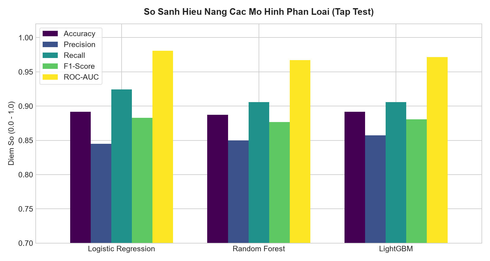

# Student Academic Risk Predictor

[Tiếng Việt](README.md) · [English](README.en.md)

Thử nghiệm phân loại nguy cơ học vụ trên 1.200 hồ sơ **mô phỏng**. Đây là bài tập về quy trình ML, chưa được kiểm chứng trên sinh viên thật.



Biểu đồ được tạo từ mô hình đã lưu sau bước chọn trên validation; các điểm số này thuộc dữ liệu mô phỏng.

## Chạy

```sh
python -m venv .venv
# Activate the environment, then:
pip install -r requirements.txt
python -m src.train
python -m src.evaluate
python -m src.explain
python -m uvicorn app.main:app --port 8000
```

Mở http://localhost:8000. Chạy kiểm thử bằng `python -m unittest discover -s tests`.

## Đánh giá

Dữ liệu được chia cố định thành 60% train, 20% validation và 20% test, có phân tầng nhãn. So sánh Logistic Regression, Random Forest và LightGBM trên validation; chọn mô hình và ngưỡng tại đây. Sau đó mới tính kết quả test. Mô hình không được huấn luyện lại sau khi chọn ngưỡng.

`models/model_metadata.json` lưu số mẫu, kết quả validation và test. Các biểu đồ được tạo từ mô hình đã lưu, không huấn luyện lại một mô hình khác để vẽ.

SHAP giải thích chính `best_model.joblib`. Với Logistic Regression, giá trị đóng góp ở thang log-odds; với mô hình cây, trường `output_space` trong API ghi rõ thang đo. Không nên đọc SHAP như mức tăng xác suất theo phần trăm.

## Giới hạn

Nhãn được sinh từ các đặc trưng và nhiễu trong `src/data_loader.py`. Điểm test cao chủ yếu cho thấy mô hình học được quy luật mô phỏng. Muốn dùng thực tế cần dữ liệu có nguồn, đánh giá theo học kỳ và kiểm tra độ hiệu chuẩn xác suất.

## Files

- `src/train.py`: chia dữ liệu, so sánh mô hình, chọn ngưỡng.
- `src/evaluate.py`: biểu đồ từ các mô hình đã lưu.
- `src/explain.py`: SHAP cho mô hình dự đoán.
- `app/`: API và giao diện thử hồ sơ.
